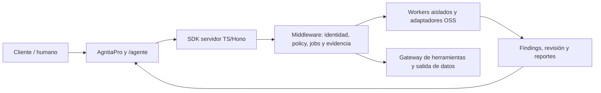

# Agntia Ciberseguridad

**Middleware de ciberseguridad tradicional y agéntica para AgntiaPro y su repositorio madre `/agente`.** Observa activos autorizados, reúne evidencias, prepara auditorías y reportes, controla las acciones de agentes y propone remediaciones revisables.

**Estado al2026-11-10: fundación documental e investigación. No hay un servicio de protección implementado ni activo.** No se han instalado scanners, conectado clientes, modificado `/agente`, comprado suscripciones o desplegado infraestructura. Los controles descritos son el objetivo de implementación; las comprobaciones iniciales solo validan documentación/configuración.

## Campaña de implementación de siete días

[**Campaña maestra y entregables diarios**](docs/campaigns/2026-11-10-seven-days/README.md): **42 fases, 294 microtareas y 84 escenarios de aceptación**, con dependencias, responsables funcionales, contratos, evidencia y rollback. Incluye observabilidad, AppSec, seguridad agéntica, privacidad/cumplimiento, costes, SDK y validación E2E. Es un plan ejecutable, no una implementación ya realizada ni una promesa de paridad global en una semana.

[Descargar la documentación y campaña en ZIP](https://github.com/uniscrolliabrain-cloud/agntia-ciberseguridad/raw/refs/heads/main/downloads/agntia-ciberseguridad-documentacion-7-dias-2026-11-10.zip). El ZIP es un snapshot de documentación/configuración/validadores; no instala un SOC.

## Qué queremos construir

Un equipo humano/agéntico dirigido desde AgntiaPro que pueda contestar «qué riesgos tiene mi software», «qué puede hacer este agente con mis datos», «qué cambió» y «qué debemos corregir primero», con fuentes, cobertura y responsables. El producto combina:

- **AppSec:** secretos, SAST, dependencias, contenedores, IaC, SBOM y revisión de cambios.
- **Seguridad de agentes/IA:** identidad, scopes, tools/MCP/skills, inyección de prompts, memoria/RAG, salida de datos y supply chain.
- **Cloud/runtime:** inventario, configuraciones, ingestión de eventos y conectores según entorno y autorización.
- **Antifraude:** señales de phishing/suplantación, procedencia y verificación por canal confiable de acciones sensibles.
- **Cumplimiento con evidencias:** aplicabilidad y controles RGPD/GDPR, AI Act y otros regímenes relevantes, con revisión humana.
- **Respuesta controlada:** casos, propuestas de parche/contención, aprobaciones, retest y recuperación; no cambios irreversibles autónomos.
- **Reportes:** ejecutivo, técnico y de cumplimiento, distinguiendo hechos, sospechas, exclusiones y pruebas no ejecutadas.

La seguridad reduce riesgos; no prometemos blindaje absoluto, cero errores, certificación legal automática o reemplazar un SOC humano24/7. Aprender de Wiz, PaloAlto, CrowdStrike, Microsoft, SentinelOne, Google/Mandiant, Cloudflare, Snyk y Semgrep no significa copiar sus productos ni adquirir sus suites dentro de un presupuesto pequeño.

## Arquitectura propuesta



Python/FastAPI para el core y un cliente TypeScript/Hono/pnpm son una propuesta que habrá que contrastar con el repo madre. `/agente` conserva identidad organizacional, experiencia, SOP y rotas; este servicio no crea otro runtime empresarial. No hay un proxy de shell/model/method libre para los LLM.

## Qué aporta la investigación inicial

Se han contrastado **metadatos de31 repositorios públicos**, registrado ocho referencias de código y estudiado selectivamente **siete papers**, incluidos trabajos de2026 sobre evaluación agéntica y prompt injection. Se han revisado noticias recientes, productos de referencia y fuentes regulatorias. No se reprodujeron benchmarks ni se auditó todo ese código; los estados y límites están en [research](docs/research/07-papers-y-noticias.md).

Dirección elegida: control determinista de permisos/argumentos/destinos, separación de datos no confiables y control, manifiestos de herramientas versionados, trazabilidad de evidencia y evaluación simultánea de seguridad/utilidad. Un clasificador de prompts es una señal más, no la frontera de seguridad.

La selección inicial propuesta es Gitleaks + OSV-Scanner + Semgrep CE con reglas revisadas; Trivy cuando existan imágenes/IaC. Wazuh, OpenSearch, eBPF y el resto del catálogo no son dependencias obligatorias del plan pequeño. Presidio y NeMo tienen rutas canónicas actualizadas; las licencias de herramientas, reglas, feeds/modelos y prestación comercial se revisan por separado.

## Planes de coste técnico

| Plan | Techo objetivo EUR/mes | Perfil piloto propuesto |
|---|---:|---|
| Lite | **30€** | Pocos repos/agentes, auditoría acotada, sin SIEM pesado obligatorio |
| L | **70€** | Más frecuencia y conectores opcionales dentro de presupuesto |
| XL | **300€** | Más activos/evaluación y servicios seleccionados; no cobertura ilimitada |

Son límites de diseño por workspace/tenant piloto que deben confirmarse antes de una oferta. [plans.json](config/plans.json) distribuye cómputo, almacenamiento, APIs, servicios y reserva fiscal/FX. **No son cotizaciones ni un enforcement ya implementado.** No incluyen trabajo humano, puesta en marcha, asesoría jurídica o hosting de la aplicación del cliente. Las suscripciones no se activan automáticamente y las anualidades no se disfrazan de gasto mensual de caja.

Los tres planes mantienen el mismo suelo de aislamiento, autorización, secretos, auditoría y aprobación. Las cuotas cambian cobertura/frecuencia, no rebajan controles básicos. VirusTotal public API queda fuera de la base comercial por sus términos; servicios empresariales de precio no verificado no se anuncian como incluidos.

## Empezar por los documentos

1. [Índice completo](docs/README.md).
2. [Visión y requisitos](docs/01-vision-y-requisitos.md).
3. [Arquitectura](docs/02-arquitectura-y-confianza.md) y [seguridad agéntica](docs/03-seguridad-agentica-y-conceptos-propios.md).
4. [Catálogo OSS](docs/04-herramientas-oss-y-adaptadores.md), [cumplimiento europeo](docs/05-cumplimiento-europeo.md) y [presupuestos](docs/06-planes-presupuesto-y-servicios.md).
5. [Papers/noticias](docs/research/07-papers-y-noticias.md) y [compañías](docs/research/08-companias-y-capacidades.md).
6. [Contrato propuesto con /agente](docs/09-contrato-con-agente.md), [roadmap](docs/10-roadmap-operaciones-y-aceptacion.md), [reportes/casos](docs/11-reportes-y-casos-de-uso.md) y [handoff](docs/12-estado-inicial-y-handoff.md).

## Validación disponible

Requiere únicamente Python3.12 recomendado, sin dependencias externas:

```bash
python scripts/validate_foundation.py
```

Comprueba enlaces locales, JSON, catálogo y coherencia de presupuesto. **No analiza vulnerabilidades ni demuestra protección.** No hay todavía comando para arrancar API, instalar el middleware en `/agente` o activar agentes. El siguiente incremento es core con identidad/scope y fixtures; después pocos adaptadores probados de extremo a extremo.

## Licencia, datos y seguridad

El propietario elegirá la licencia del código propio antes de una distribución que la requiera; un repositorio público no implica licencia libre. No se ha copiado código de terceros. Cada upstream conserva sus términos. Nunca guardar clientes/secretos/muestras en Git público; [SECURITY.md](SECURITY.md) describe el canal privado pendiente y [AGENTS.md](AGENTS.md) las instrucciones de continuidad.
