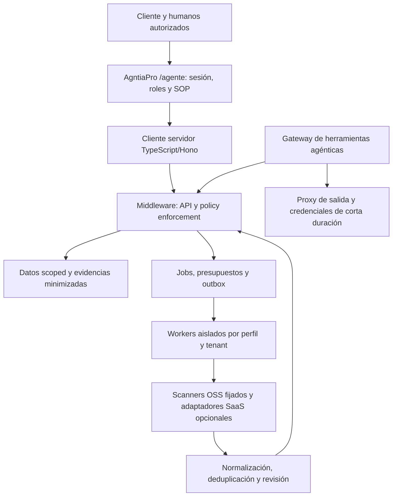

# 02 · Arquitectura objetivo y límites de confianza

Estado: diseño propuesto, no servicios implementados. Fecha: 2026-11-10.

## Propuesta técnica

Python3.12/FastAPI/Pydantic para core, adaptadores de CLI e investigación; cliente TypeScript/Hono/pnpm para el consumidor. Contrastar con interfaces reales del repo madre antes de fijar contrato. No modificarlo durante esta fase. Para un piloto pequeño puede usarse SQLite transaccional y worker único con leases; para servicio multiusuario/multitenant se prefiere PostgreSQL con constraints, colas persistidas y políticas de aislamiento verificadas. Redis solo si hay una necesidad medida; no duplicar datos autoritativos en caché.

El endpoint agéntico de policy debe ser local/privado y de baja latencia. Sus decisiones se producen fuera del LLM con política determinista versionada. OPA o Cedar son candidatos, no dependencias adoptadas aún. Elegir uno tras evaluar expresividad, coste de operación y facilidad de pruebas. OpenFGA puede resolver relaciones organizacionales si el repo madre no ofrece una función equivalente.

## Entidades fundamentales

Tenant, Principal, Asset, AuthorizationGrant, ToolManifest, PolicyBundle, CredentialRef, ScanProfile, Snapshot, Job, Finding, EvidenceRef, Incident, RemediationProposal, Approval, BudgetReservation, AuditEvent y RegulatoryAssessment. Cada entidad de cliente incluye tenant, scope, revisión, retención y procedencia. No mezclar IDs de empresa, repositorio y tenant ni mapearlos solo por nombre.

La autorización de auditoría registra titular/representación, activos, paths/hosts/IP, entorno, tipo de prueba, exclusiones, ventana, límites, contacto y revocación. El sistema valida el objetivo final después de resolver DNS y en cada redirección permitida; los scanners no pueden salir de scope porque una web enlace a otro dominio. La concesión expirada corta nuevas operaciones y se reevalúa al reclamar un job.

## Workers y supply chain

Separar adquisición, análisis estático, pruebas activas de laboratorio e ingestión de eventos. Un worker no tiene montaje del socket Docker del host, credenciales globales, acceso a otros tenants o privilegios root innecesarios. Usar UID no privilegiado, FS temporal, límites CPU/RAM/pids/tiempo/salida, seccomp y red por allowlist. Un scanner que necesita privilegios de kernel/runtime vive en un componente específico con un análisis de riesgo propio, nunca en el worker genérico Lite.

Analizar código sin instalar sus dependencias con scripts de postinstall ni ejecutar tests del cliente por defecto. Git hooks/submódulos/LFS y paquetes con código nativo se tratan como material no confiable. La validación que requiera ejecutar código ocurre en sandbox desechable con aprobación de perfil y datos sintéticos. No hay capacidades cloud de producción en ese sandbox.

Fijar versiones/digests y reglas, producir SBOM del propio middleware, verificar procedencia/firmas cuando estén disponibles y actualizar con canary/reversión. Un hash de rama observado en investigación no es una release aprobada ni se considera un lock de dependencias. Las bases CVE y reglas también tienen fecha y licencia; reportar su antigüedad.

## Credenciales y ejecución

Secret manager o referencias inyectadas, no secretos en SQLite, bodies, logs o prompts. Credenciales separadas por cliente/proveedor y privilegio mínimo, preferiblemente cortas y con audiencia. El gateway intercambia credenciales en servidor; un token del usuario no se reenvía ciegamente a un MCP externo. Renovación y revocación deben probarse.

Deny-by-default para efectos externos. Dry-run captura snapshot, diff, riesgo, coste máximo, objetivo y hash; aprobación ligada a esos campos con caducidad. Un cambio de contenido o destino la invalida. Las ampliaciones de permisos requieren autorización explícita; las reducciones seguras pueden aplicarse conforme a política. Persistir idempotencia antes de un efecto externo y reconciliar tras timeout; nunca asumir exactly-once HTTP.

## Datos, evidencia y ataque al auditor

Salidas de herramientas, logs, SARIF, PDFs y comentarios de código pueden incluir inyección de prompts y contenido activo. Normalizar con schemas, cotas y escape; no renderizar HTML externo ni ejecutar enlaces como instrucciones. La parte que resume evidencia no posee permisos para cambiar infraestructura. Validar todos los resultados del LLM como propuestas no confiables.

Guardar evidencias cifradas, minimizadas y scoped; separar originales, extractos redactados y reportes. La redacción puede fallar: Presidio es un candidato de asistencia, no una garantía universal de anonimización. Cifrado, derechos de acceso y retención siguen siendo necesarios incluso después de redactar. Los hashes prueban correspondencia con el contenido disponible, no identidad ni verdad del contenido.

Cadena audit local y checkpoints firmados fuera del proceso mejoran detección de alteración. La modificación por un administrador con todas las claves sigue en el modelo de amenaza; documentar trust roots y restauración. No prometer forense legalmente admisible solo por calcular SHA256.

## Fallos y disponibilidad

Separar la ruta de enforcement de presupuestos y del LLM remoto. Si cae el LLM, las reglas siguen funcionando; si no se puede verificar una acción de alto impacto se deniega. Las lecturas permitidas en degradación deben estar predefinidas, con decisiones y limitaciones registradas. Política caducada, hora dudosa, evento repetido o caché de permisos antigua no se resuelven con fallback a owner.

Un kill switch revoca autorizaciones/capacidades del agente y bloquea nuevas llamadas en el gateway. No promete cancelar una operación ya aceptada por un tercero ni deshacer un pago. Efectos en curso se concilian y cambios ya aplicados se revierten mediante playbooks aprobados. La ejecución de agentes por caminos alternativos fuera del gateway constituye un bypass que debe detectarse y cerrarse.
